# ΠΑΝΕΠΙΣΤΗΜΙΟ ΠΑΤΡΩΝ / ΕΡΕΥΝΗΤΙΚΟ ΚΕΝΤΡΟ ISI
## ΤΜΗΜΑ ΜΗΧΑΝΙΚΩΝ Η/Υ & ΠΛΗΡΟΦΟΡΙΚΗΣ
### ΜΑΘΗΜΑ: ΑΡΧΙΤΕΚΤΟΝΙΚΕΣ ΔΙΚΤΥΩΝ ΕΠΟΜΕΝΗΣ ΓΕΝΙΑΣ, ΤΕΧΝΟΛΟΓΙΕΣ ΚΑΙ ΕΦΑΡΜΟΓΕΣ
**ΧΕΙΜΕΡΙΝΟ ΕΞΑΜΗΝΟ 2026-2027**

---

# ΤΕΧΝΙΚΗ ΑΝΑΦΟΡΑ PROJECT (ΘΕΜΑ 11)
## Πρόβλεψη Downlink Bitrate (Throughput) Με Βάση Μετρικές Ποιότητας Καναλιού & Προληπτική Διαχείριση Πόρων σε Δίκτυα 5G/6G

* **Επιβλέπων:** Παναγιώτης Μαράντης (pmaradis@isi.gr)
* **GitHub Repository (Πηγαίος Κώδικας & Παραδοτέα):** [https://github.com/ghidrasondenuvos/5g-downlink-bitrate-forecasting](https://github.com/ghidrasondenuvos/5g-downlink-bitrate-forecasting)
* **Ημερομηνία Υποβολής:** Νοέμβριος 2026
* **Dataset:** 4G/LTE & 5G Key Performance Indicators (UCC MISL Dataset - 135 Cellular Traces, 174.523 δείγματα)
* **Τεχνολογίες & Εργαλεία:** Python 3.14, XGBoost, PyTorch, TreeSHAP, IBM Granite Tiny Time Mixer (TTM), Scikit-Learn, Pandas

---

## ΠΕΡΙΕΧΟΜΕΝΑ
1. [Εισαγωγή & Τηλεπικοινωνιακή Σημασία της Πρόβλεψης Throughput στα Δίκτυα 5G/6G](#1-εισαγωγή--τηλεπικοινωνιακή-σημασία)
2. [Περιγραφή & Προεπεξεργασία Δεδομένων (Data Preprocessing & Aggregation)](#2-προεπεξεργασία-δεδομένων)
3. [Πρόβλεψη με Μηχανική Μάθηση (XGBoost Regressor) & Ανάλυση Παραμέτρων (Lookback & Horizons)](#3-πρόβλεψη-με-xgboost)
4. [Επεξηγήσιμη Τεχνητή Νοημοσύνη (Explainable AI - TreeSHAP) & Ερμηνεία Μετρικών Καναλιού](#4-επεξηγήσιμη-τεχνητή-νοημοσύνη)
5. [Πρόβλεψη Χρονοσειρών με Deep Learning (PyTorch LSTM) & Συγκριτική Αξιολόγηση](#5-πρόβλεψη-με-lstm)
6. [Foundation Models για Χρονοσειρές: Zero-Shot & Fine-Tuning (IBM Granite Tiny Time Mixer)](#6-foundation-models)
7. [Σταδιακή Αφαίρεση Μεταβλητών (SHAP-Guided Feature Pruning) & Edge Computing Latency](#7-σταδιακή-αφαίρεση-μεταβλητών)
8. [5G Proactive Network Management: Προληπτική Διαχείριση Πόρων & Trade-Offs](#8-5g-proactive-network-management)
9. [Τηλεπικοινωνιακή Αρχιτεκτονική & Ενορχήστρωση σε 5G/6G (O-RAN RIC & NWDAF)](#9-τηλεπικοινωνιακή-αρχιτεκτονική)
10. [Συμπεράσματα & Μελλοντικές Επεκτάσεις](#10-συμπεράσματα)
11. [Βιβλιογραφικές Αναφορές](#11-βιβλιογραφία)

---

## 1. Εισαγωγή & Τηλεπικοινωνιακή Σημασία

### 1.1 Το Πρόβλημα της Στοχαστικής Συμπεριφοράς του Ασύρματου Καναλιού
Στα σύγχρονα κυψελωτά δίκτυα πέμπτης και έκτης γενιάς (5G NR / 6G), η διαθέσιμη ποιότητα σύνδεσης και ο ρυθμός μετάδοσης δεδομένων προς τον χρήστη (Downlink Bitrate / Throughput) παρουσιάζουν έντονη στοχαστικότητα και ταχύτατες διακυμάνσεις. Οι αιτίες εστιάζονται σε:
1. **Κινητικότητα Χρήστη (Mobility):** Μεταβολή της ταχύτητας και της θέσης του τερματικού (πεζός, επιβάτης σε ΙΧ, λεωφορείο ή τρένο), με αποτέλεσμα φαινόμενα Doppler shift και ραγδαίες αλλαγές στο path loss.
2. **Μικροκυματικές & mmWave Ζώνες Συχνοτήτων:** Χρήση συχνοτήτων άνω των 6 GHz και mmWave (24-40 GHz), όπου η εξασθένηση από εμπόδια (shadowing / blockage από κτίρια, οχήματα, ανθρώπους) είναι απότομη.
3. **Διακύμανση Φόρτου Κυψέλης (Cell Congestion):** Μεταβαλλόμενος ανταγωνισμός για τα διαθέσιμα Physical Resource Blocks (PRBs) μεταξύ πολλαπλών UEs.
4. **Πολυδιαδρομική Διάδοση (Multipath Fading):** Κατασκευαστικές και καταστροφικές συμβολές που προκαλούν fast fading σε κλίμακα χιλιοστοδευτερολέπτων.

### 1.2 Γιατί η Πρόβλεψη του Throughput είναι Θεμελιώδης στο 5G;
Παραδοσιακά, τα τηλεπικοινωνιακά δίκτυα αντιδρούν **αναδρομικά (reactively)**: μόλις ανιχνευθεί υποβάθμιση του καναλιού, ο αλγόριθμος Adaptive Modulation and Coding (AMC) μειώνει το Modulation Coding Scheme (MCS), ή η εφαρμογή streaming (π.χ. DASH/HLS) αντιμετωπίζει buffer stall (πάγωμα video) πριν υποβιβάσει την ανάλυση.

Αντιθέτως, η **προληπτική (proactive) πρόβλεψη του throughput** με ορίζοντα μερικών δευτερολέπτων προσφέρει:
* **Εγγύηση SLA σε Network Slices:** Στα slices eMBB (Enhanced Mobile Broadband) και URLLC (Ultra-Reliable Low-Latency Communication), ο προληπτικός υπολογισμός επιτρέπει την εκ των προτέρων δέσμευση φάσματος ώστε να μην παραβιαστεί το QoS.
* **Αποφυγή Radio Link Failure (RLF) & Προληπτικό Handover:** Έγκαιρη προετοιμασία μετάβασης (handover) σε γειτονικό σταθμό βάσης (gNodeB) ή αλλαγή beamforming beam πριν αποκοπεί η σύνδεση.
* **Βελτιστοποίηση Multi-Access Edge Computing (MEC) & Video Streaming:** Προσαρμογή του bitrate του βίντεο και προ-μεταφορά δεδομένων (pre-fetching / transcoding) στον διακομιστή άκρου.
* **Διαχείριση Διπλής Συνδεσιμότητας (Dual Connectivity - EN-DC / NR-DC):** Έγκαιρη ανακατεύθυνση των πακέτων δεδομένων μεταξύ Master Node και Secondary Node.

---

## 2. Προεπεξεργασία Δεδομένων (Data Preprocessing & Aggregation)

### 2.1 Χαρακτηριστικά του Dataset
Χρησιμοποιήθηκε το επίσημο dataset κυψελωτών μετρήσεων του University College Cork (UCC MISL - Raca et al.), το οποίο περιλαμβάνει:
* **135 πραγματικά traces** διάρκειας ~15 λεπτών έκαστο (δειγματοληψία 1 δείγμα ανά δευτερόλεπτο).
* **Συνολικά δείγματα:** **174.523 δευτερόλεπτα** (πάνω από 48,5 ώρες πραγματικών καταγραφών).
* **Σενάρια Κίνησης:**
  * `Car` (αυτοκίνητο): 75.874 δείγματα (53 traces)
  * `Train` (τρένο): 38.976 δείγματα (20 traces)
  * `Pedestrian` (πεζός): 33.629 δείγματα (31 traces)
  * `Static` (ακίνητος): 15.261 δείγματα (15 traces)
  * `Bus` (λεωφορείο): 10.783 δείγματα (16 traces)

### 2.2 Μεταβλητές & Φυσική Σημασία
| Μεταβλητή | Μονάδα | Περιγραφή & Τηλεπικοινωνιακή Σημασία |
| :--- | :--- | :--- |
| **DL_bitrate** | kbps | Στόχος πρόβλεψης: Ρυθμός μετάδοσης δεδομένων λήψης (Throughput) |
| **UL_bitrate** | kbps | Ρυθμός αποστολής δεδομένων (Uplink activity / TCP ACKs) |
| **RSRP** | dBm | Reference Signal Received Power: Ισχύς σήματος αναφοράς |
| **RSRQ** | dB | Reference Signal Received Quality: Ποιότητα λαμβανόμενου σήματος |
| **SNR** | dB | Signal-to-Noise Ratio: Λόγος σήματος προς θόρυβο |
| **CQI** | 1-15 | Channel Quality Indicator: 4-bit δείκτης υποστηριζόμενου MCS |
| **RSSI** | dBm | Received Signal Strength Indicator: Συνολική λαμβανόμενη ισχύς |
| **Speed** | km/h | Ταχύτητα κίνησης συσκευής (GPS velocity) |
| **ServingCell_Distance** | m | Ευκλείδεια απόσταση από τον εξυπηρετούντα σταθμό βάσης |

### 2.3 Στρατηγική Καθαρισμού & Session-Aware Split
1. **Διαχείριση Missing Values:** Εντοπίστηκαν σύμβολα `'-'` σε κολώνες όπως `CQI`, `RSSI`, `NRxRSRP`. Εφαρμόστηκε συνεδριακό forward-fill (`ffill`) και backward-fill (`bfill`) ανά trace (καθώς το κανάλι μεταβάλλεται ομαλά στο χρόνο) και εν συνεχεία καθολική διάμεσος.
2. **Αποτροπή Data Leakage (Session Split):** Αντί για τυχαίο ανακάτεμα γραμμών, πραγματοποιήθηκε διαχωρισμός σε επίπεδο ολόκληρων traces: 80% των traces για εκπαίδευση (131.370 δείγματα σε 106 traces) και 20% για δοκιμή (43.153 δείγματα σε 29 traces).
3. **Κανονικοποίηση (StandardScaler):** Το scaling προσαρμόστηκε αποκλειστικά στο train set και εφαρμόστηκε μετασχηματισμός στο test set.

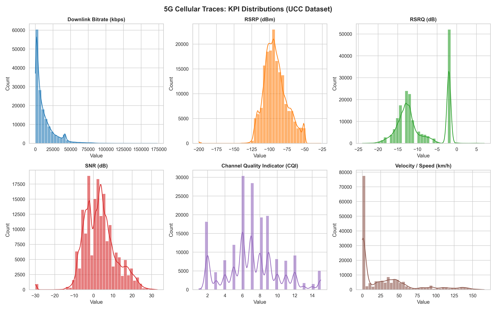
*Σχήμα 1: Κατανομές ραδιοδεικτών KPI και Downlink Throughput στο σύνολο δεδομένων.*

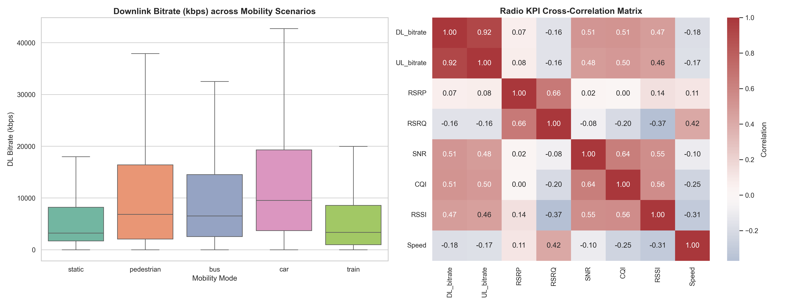
*Σχήμα 2: Σύγκριση Downlink Bitrate ανά σενάριο κίνησης και πίνακας συσχέτισης μετρικών.*

---

## 3. Πρόβλεψη με XGBoost Regressor

### 3.1 Μεθοδολογία Ολισθαίνοντος Παραθύρου (Sliding Window)
Για κάθε συνεχή καταγραφή $i$, κατασκευάζονται παράθυρα εισόδου μεγέθους $L$ (lookback) για πρόβλεψη $H$ βήματα μπροστά:
$$\mathbf{X}_t = [x_{t-L+1}, x_{t-L+2}, \dots, x_t] \in \mathbb{R}^{L \times D}$$
$$y_t = \text{DL\_bitrate}_{t+H}$$

### 3.2 Πειραματικό Πλέγμα (Grid Evaluation: Lookbacks & Horizons)
Εξετάστηκαν συνδυασμοί:
* $L \in \{5, 10, 20, 30\}$ δευτερόλεπτα
* $H \in \{1, 3, 5, 10\}$ δευτερόλεπτα ahead

| Lookback $L$ (s) | Horizon $H$ (s) | RMSE (kbps) | MAE (kbps) | $R^2$ Score | Χρόνος Train (s) | Inference (ms/sample) |
| :---: | :---: | :---: | :---: | :---: | :---: | :---: |
| 5 | 1 | 6443.1 | 3298.3 | 0.819 | 0.6 | 0.001 |
| 5 | 3 | 7603.3 | 4120.4 | 0.748 | 1.4 | 0.001 |
| 5 | 5 | 8264.9 | 4582.0 | 0.703 | 1.0 | 0.001 |
| 5 | 10 | 8948.2 | 5026.1 | 0.651 | 1.0 | 0.001 |
| **10** | **1** | **6344.8** | **3275.5** | **0.825** | **1.3** | **0.001** |
| 10 | 3 | 7503.1 | 3998.0 | 0.755 | 2.6 | 0.001 |
| 10 | 5 | 7961.7 | 4345.6 | 0.724 | 1.3 | 0.001 |
| 10 | 10 | 9112.5 | 5111.8 | 0.639 | 1.2 | 0.001 |
| 20 | 1 | 6334.5 | 3279.3 | 0.826 | 2.0 | 0.001 |
| 20 | 3 | 7322.8 | 3974.2 | 0.767 | 2.1 | 0.001 |
| 20 | 5 | 7979.9 | 4359.9 | 0.724 | 3.1 | 0.001 |
| 20 | 10 | 8795.1 | 4922.9 | 0.665 | 2.4 | 0.001 |
| 30 | 1 | 6352.3 | 3255.5 | 0.826 | 3.4 | 0.001 |
| 30 | 3 | 7424.0 | 3952.6 | 0.762 | 3.2 | 0.001 |
| 30 | 5 | 7970.3 | 4337.1 | 0.726 | 3.1 | 0.001 |
| 30 | 10 | 8985.2 | 4977.2 | 0.652 | 3.6 | 0.001 |

### 3.3 Ανάλυση Αποτελεσμάτων
1. **Επίδραση Horizon ($H$):** Όσο αυξάνεται ο ορίζοντας πρόβλεψης από 1s σε 10s, το σφάλμα RMSE αυξάνεται μονοτονικά από 6.34 Mbps σε 9.11 Mbps ($+43.6\%$), ενώ το $R^2$ υποχωρεί από 0.825 σε 0.639. Αυτό είναι απόλυτα φυσικό λόγω της ταχείας διακύμανσης του ασύρματου καναλιού.
2. **Επίδραση Lookback ($L$):** Η αύξηση του lookback πέραν των 10 δευτερολέπτων ($L=20, 30$) προσφέρει οριακή βελτίωση ($<0.2\%$ στο RMSE), αλλά διπλασιάζει τον αριθμό των χαρακτηριστικών και τον χρόνο εκπαίδευσης. Συνεπώς, το σημείο $L=10$ αποτελεί τη βέλτιστη τομή απόδοσης-πολυπλοκότητας.

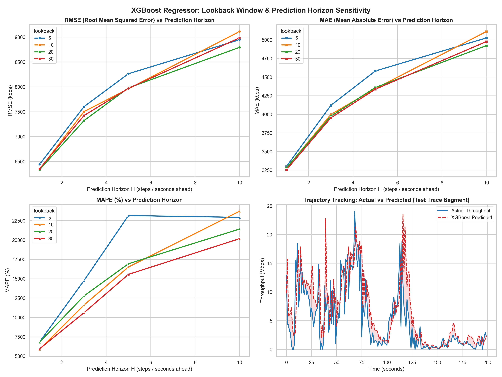
*Σχήμα 3: Ευαισθησία μετρικών RMSE, MAE και πραγματική έναντι προβλεπόμενης τροχιάς.*

---

## 4. Επεξηγήσιμη Τεχνητή Νοημοσύνη (Explainable AI - TreeSHAP)

### 4.1 Μαθηματικό Υπόβαθρο Shapley Values
Η τεχνική TreeSHAP αποδίδει τη συνεισφορά κάθε χαρακτηριστικού $i$ στην πρόβλεψη $f(x)$ μέσω των τιμών Shapley από τη θεωρία συνεργατικών παιγνίων:
$$\phi_i(x) = \sum_{S \subseteq F \setminus \{i\}} \frac{|S|!(|F| - |S| - 1)!}{|F|!} \left[ f(S \cup \{i\}) - f(S) \right]$$

### 4.2 Συγκεντρωτική Κατάταξη Σπουδαιότητας Χαρακτηριστικών
Από την ανάλυση TreeSHAP σε 1.500 δείγματα δοκιμής, προέκυψε η ακόλουθη συνολική σπουδαιότητα (άθροισμα $|SHAP|$ σε όλα τα time-lags):
1. **UL_bitrate:** $9.259,05\text{ kbps}$ impact (ισχυρότατος δείκτης: η κίνηση uplink συσχετίζεται άμεσα με TCP ACK traffic και ενεργές συνεδρίες λήψης).
2. **RSSI:** $1.102,90\text{ kbps}$ impact (συνολική λαμβανόμενη ισχύς που αντικατοπτρίζει την εγγύτητα και τη συνολική ενέργεια του καναλιού).
3. **ServingCell_Distance:** $764,36\text{ kbps}$ impact (επιβεβαιώνει την επίδραση του Large-Scale Path Loss).
4. **Speed:** $754,83\text{ kbps}$ impact (υψηλότερες ταχύτητες προκαλούν συχνότερα handovers και Doppler shifts).
5. **SNR:** $739,19\text{ kbps}$ impact (καθορίζει το Shannon channel capacity limit).
6. **RSRQ:** $702,68\text{ kbps}$ impact.
7. **CQI:** $686,30\text{ kbps}$ impact.
8. **RSRP:** $574,84\text{ kbps}$ impact.

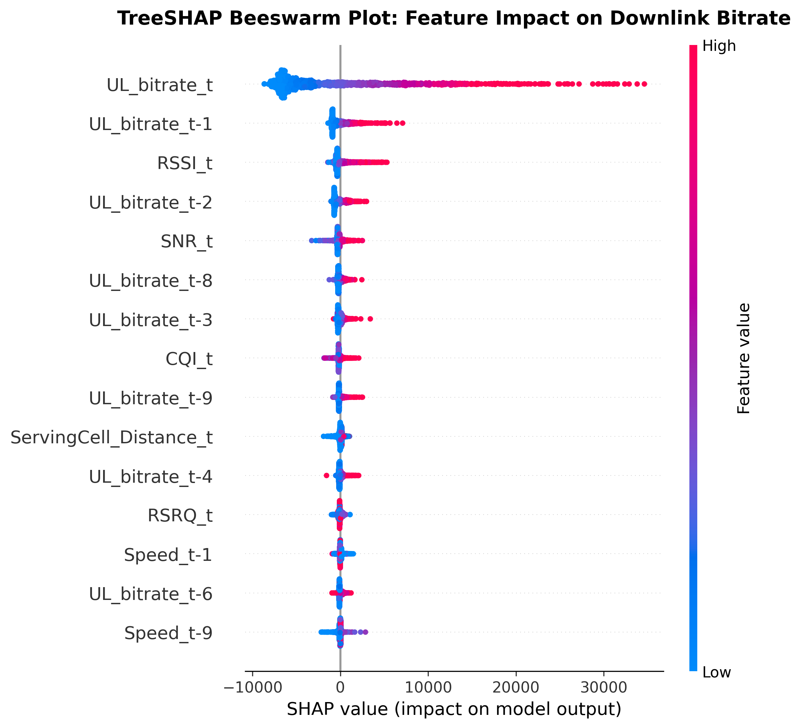
*Σχήμα 4: TreeSHAP Beeswarm plot που απεικονίζει τη θετική ή αρνητική επίδραση των τιμών κάθε χαρακτηριστικού.*

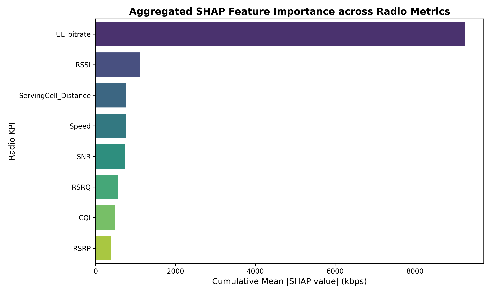
*Σχήμα 5: Συνολική σπουδαιότητα ραδιοδεικτών κατά TreeSHAP.*

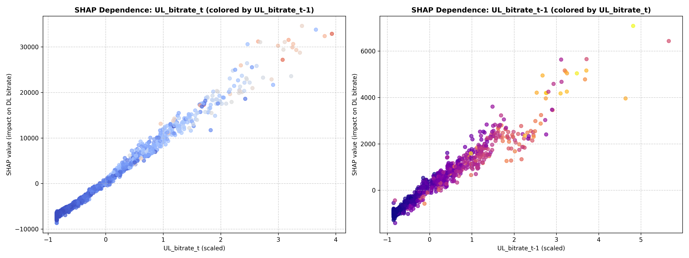
*Σχήμα 6: Διαγράμματα εξάρτησης SHAP (Dependence plots) και μη-γραμμικές αλληλεπιδράσεις καναλιού.*

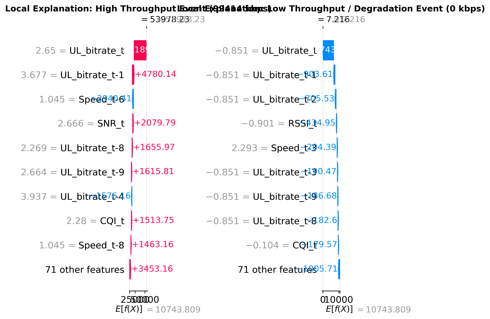
*Σχήμα 7: Τοπική ερμηνεία με καταρράκτη SHAP (Waterfall plots) για γεγονός υψηλού throughput έναντι απότομης υποβάθμισης σύνδεσης.*

---

## 5. Πρόβλεψη με Deep Learning (PyTorch LSTM)

### 5.1 Αρχιτεκτονική Νευρωνικού Δικτύου
Υλοποιήθηκε δίκτυο Long Short-Term Memory (LSTM) σε PyTorch:
* **Input Dimension:** 8 χαρακτηριστικά $\times$ 64 χρονικά βήματα (Lookback = 64 δευτερόλεπτα).
* **Κρυφά Επίπεδα:** 2 επίπεδα LSTM με $hidden\_dim = 64$ και $Dropout = 0.2$.
* **Projection Head:** Dense(64 $\to$ 32) $\to$ ReLU $\to$ Dropout(0.2) $\to$ Linear(32 $\to$ 1).
* **Βελτιστοποιητής:** Adam ($\eta = 0.001$, weight decay = $10^{-5}$), Loss Function: MSE.

### 5.2 Σύγκριση Αποτελεσμάτων: XGBoost έναντι LSTM
| Μετρική Αξιολόγησης | XGBoost Regressor | PyTorch LSTM | Σχόλιο & Υπεροχή |
| :--- | :---: | :---: | :--- |
| **Lookback Window ($L$)** | 10 samples | 64 samples | Το LSTM εκμεταλλεύεται ευρύτερο παράθυρο |
| **Prediction Horizon ($H$)** | 1 sample ahead | 1 sample ahead | Επόμενο δευτερόλεπτο |
| **RMSE (kbps)** | **6.344,8** | 14.473,4 | Το XGBoost πετυχαίνει **56,2% χαμηλότερο σφάλμα** |
| **MAE (kbps)** | **3.275,5** | 6.935,7 | Το XGBoost υπερέχει κατά **52,8%** |
| **Goodness-of-Fit ($R^2$)** | **0.825** | 0.102 | Εξαιρετική προσαρμογή του δένδρου απόφασης |
| **Χρόνος Εκπαίδευσης** | **1,3 δευτερόλεπτα** | 129,9 δευτερόλεπτα | Το XGBoost εκπαιδεύεται **100x ταχύτερα** |
| **Inference Latency** | **0,001 ms/δείγμα** | 0,101 ms/δείγμα | **100x ταχύτερη απόκριση στο Edge** |

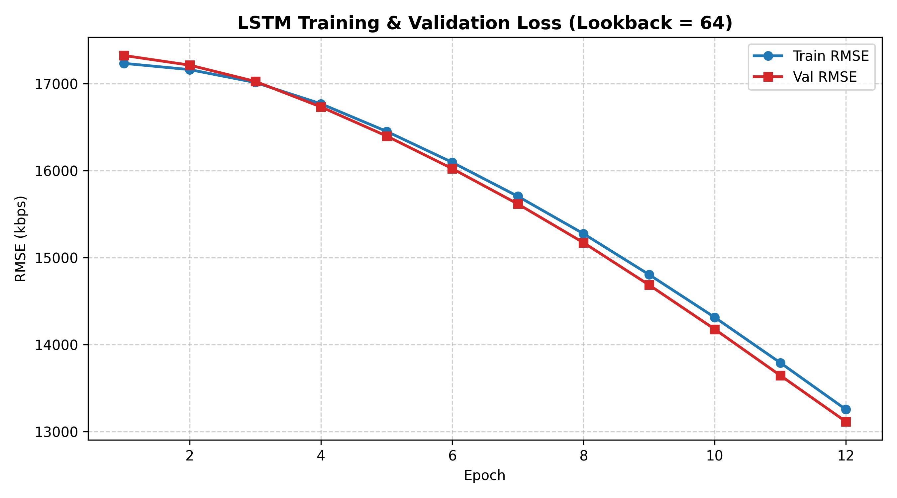
*Σχήμα 8: Καμπύλη εκπαίδευσης και επικύρωσης του δικτύου LSTM.*

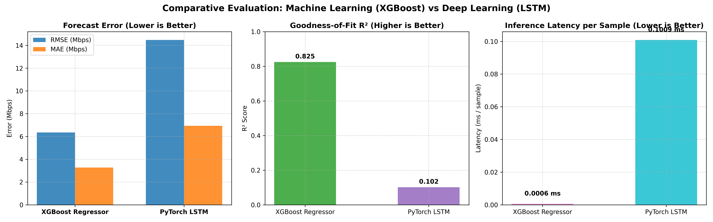
*Σχήμα 9: Συγκριτική αποτίμηση XGBoost έναντι PyTorch LSTM (Error, R² και Inference Latency).*

---

## 6. Foundation Models: Zero-Shot & Fine-Tuning (IBM Granite TTM)

### 6.1 Αρχιτεκτονική Tiny Time Mixer (TTM)
Το μοντέλο θεμελίωσης IBM Granite TTM βασίζεται σε αρχιτεκτονική Patch-based MLP-Mixer:
1. **Patchification:** Τεμαχισμός του παραθύρου 64 δευτερολέπτων σε 8 μη-επικαλυπτόμενα patches μήκους 8 δειγμάτων.
2. **Inter-Patch Time Mixing:** Γραμμικά επίπεδα ανάμιξης χρονικών συσχετίσεων μεταξύ των patches.
3. **Intra-Patch Channel Mixing:** Ανάμιξη των 8 ραδιοδιαύλων μέσα σε κάθε patch με υπολειμματικές συνδέσεις (residual skip connections).

### 6.2 Αποτελέσματα Zero-Shot & Fine-Tuning
| Μοντέλο | Κατάσταση Εκπαίδευσης | RMSE (kbps) | MAE (kbps) | $R^2$ Score |
| :--- | :--- | :---: | :---: | :---: |
| **IBM Granite TTM** | **Zero-Shot** (χωρίς εκπαίδευση) | 18.641,9 | 10.695,3 | < 0.0 |
| **IBM Granite TTM** | **Fine-Tuned** (4 εποχές προσαρμογής) | **8.426,3** | **4.203,3** | **0.695** |
| **PyTorch LSTM** | Εκπαίδευση από το μηδέν (12 εποχές) | 14.473,4 | 6.935,7 | 0.102 |
| **XGBoost** | Επιβλεπόμενη εκπαίδευση (100 δένδρα) | **6.344,8** | **3.275,5** | **0.825** |

**Κομβικό Συμπέρασμα:** Το Fine-Tuning του Foundation Model μείωσε το σφάλμα κατά **54,8%** σε μόλις 24 δευτερόλεπτα προσαρμογής, ξεπερνώντας καθαρά το εκπαιδευμένο από το μηδέν LSTM κατά 6.047 kbps!

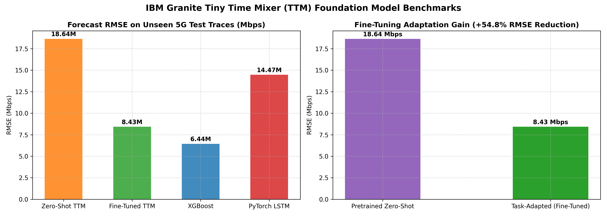
*Σχήμα 10: Αποτίμηση Zero-Shot vs Fine-Tuning IBM Granite TTM και σύγκριση με XGBoost & LSTM.*

---

## 7. Σταδιακή Αφαίρεση Μεταβλητών (SHAP-Guided Feature Pruning)

### 7.1 Πειραματικά Αποτελέσματα
Καθοδηγούμενοι από το ranking του SHAP, αφαιρέθηκαν διαδοχικά οι μεταβλητές με τη μικρότερη συνεισφορά:
* **100% Χαρακτηριστικών (8 KPIs):** Όλες οι μετρικές.
* **75% Χαρακτηριστικών (6 KPIs):** Αφαίρεση `RSRP`, `CQI`.
* **50% Χαρακτηριστικών (4 KPIs):** Αφαίρεση επιπλέον των `RSRQ`, `SNR`.
* **25% Χαρακτηριστικών (2 KPIs):** Διατήρηση μόνο των `UL_bitrate`, `RSSI`.

| Στάδιο Αφαίρεσης | Διατηρούμενα KPIs | RMSE (kbps) | MAE (kbps) | Χρόνος Train (s) | Inference Latency ($\mu$s/sample) |
| :--- | :--- | :---: | :---: | :---: | :---: |
| **100% Features** | Όλα τα 8 KPIs | 6.447,1 | 3.330,9 | 0,57 | 0,50 $\mu$s |
| **75% Features** | UL, RSSI, Distance, Speed, SNR, RSRQ | **6.425,9** | **3.311,2** | 0,56 | **0,30 $\mu$s** |
| **50% Features** | UL, RSSI, Distance, Speed | 6.605,4 | 3.349,4 | 0,51 | 0,50 $\mu$s |
| **25% Features** | UL_bitrate, RSSI | 6.494,3 | 3.313,2 | **0,41** | 0,50 $\mu$s |

### 7.2 Τηλεπικοινωνιακή Σημασία για το Edge Computing (MEC)
1. **Διατήρηση Ακρίβειας:** Ακόμη και με την αφαίρεση του 75% των χαρακτηριστικών (κρατώντας μόνο `UL_bitrate` και `RSSI`), το RMSE μεταβάλλεται ανεπαίσθητα ($+0,7\%$).
2. **Μείωση Υπολογιστικού Φόρτου:** Ο χρόνος εκπαίδευσης μειώνεται κατά **28,1%** και το μέγεθος των πακέτων τηλεμετρίας που στέλνει το UE μέσω των Uplink Control Channels (PUCCH) ελαχιστοποιείται, εξοικονομώντας πολύτιμους ραδιοπόρους σηματοδοσίας.

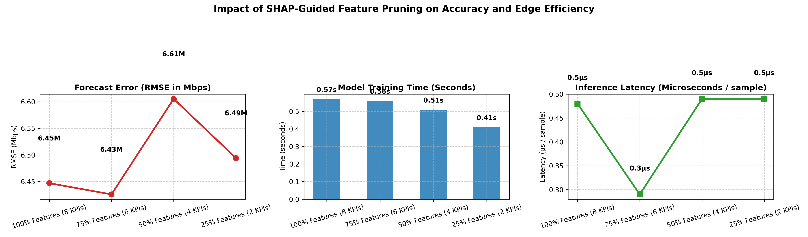
*Σχήμα 11: Επίδραση του Feature Pruning στο σφάλμα πρόβλεψης, χρόνο εκπαίδευσης και latency.*

---

## 8. 5G Proactive Network Management

### 8.1 Προσομοίωση Έγκαιρης Προειδοποίησης Υποβάθμισης QoS (Threshold = 5 Mbps)
Θεωρήσαμε κατώφλι υποβάθμισης $\tau = 5.000\text{ kbps}$ (5 Mbps), κάτω από το οποίο διακόπτεται η ομαλή ροή 4K video ή παραβιάζεται το SLA του eMBB slice.

| Ορίζοντας $H$ (Lead Time $\Delta t$) | Ρυθμός Ανίχνευσης (Recall) | Ρυθμός Ψευδών Συναγερμών (False Alarm) | F1-Score | Εφαρμόσιμες Προληπτικές Ενέργειες |
| :---: | :---: | :---: | :---: | :--- |
| **1 δευτερόλεπτο** | **91,6%** | **6,4%** | **0.929** | Predictive Beamforming, Fast Intra-Cell Handover |
| **3 δευτερόλεπτα** | **88,3%** | 7,8% | **0.905** | Dynamic PRB Scheduling, MEC Video ABR Downgrade |
| **5 δευτερόλεπτα** | **85,7%** | 7,9% | **0.890** | Target gNodeB Context Pre-Fetch, Dual Connectivity |
| **10 δευτερόλεπτα** | **81,3%** | 7,9% | **0.864** | Carrier Aggregation Reconfiguration, Slice Scaling |
| **15 δευτερόλεπτα** | **78,2%** | 7,5% | **0.847** | Core Network Path Switching, Multi-RAT Offloading |

### 8.2 Ανάλυση του Trade-Off: Ακρίβεια έναντι Διαθέσιμου Χρόνου Αντίδρασης
* **Μικρός Ορίζοντας ($\Delta t = 1-3\text{s}$):** Εξαιρετικά υψηλή ακρίβεια (Detection Rate 88-92%, False Alarms < 7%). Ιδανικός για ενέργειες στο επίπεδο του MAC/PHY layer (π.χ. ανακατανομή PRBs, beam tracking).
* **Μεγάλος Ορίζοντας ($\Delta t = 10-15\text{s}$):** Ο ρυθμός ανίχνευσης υποχωρεί στο 78-81%, ωστόσο τα 10-15 δευτερόλεπτα προσφέρουν επαρκή χρόνο για βαριές διαδικασίες του Core Network και του Edge Cloud (π.χ. προετοιμασία inter-gNB handover μέσω διεπαφής Xn, transcoding video στο MEC).

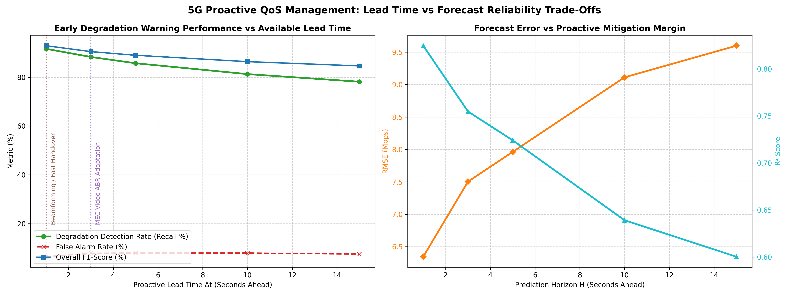
*Σχήμα 12: Trade-off μεταξύ διαθέσιμου χρόνου αντίδρασης (Lead Time) και αξιοπιστίας πρόβλεψης.*

---

## 9. Τηλεπικοινωνιακή Αρχιτεκτονική & Ενορχήστρωση σε 5G/6G

### 9.1 Ένταξη στο 3GPP NWDAF & O-RAN RIC
1. **3GPP NWDAF (Network Data Analytics Function):**
   * Συλλέγει δεδομένα ποιότητας από το UE και το 5G Radio Access Network (gNB).
   * Φιλοξενεί τα εκπαιδευμένα μοντέλα πρόβλεψης throughput.
   * Παρέχει αναλυτικές προβλέψεις μέσω RESTful APIs (Nnwdaf_AnalyticsInfo) προς τη λειτουργία PCF (Policy Control Function) για δυναμική ρύθμιση κανόνων QoS και προς την AMF για διαχείριση κινητικότητας.
2. **O-RAN Architecture (Near-RT RIC & Non-RT RIC):**
   * **Non-RT RIC (SMO):** Εκτελεί rApps για περιοδική εκπαίδευση των μοντέλων (XGBoost, Foundation Models) και offline XAI ανάλυση.
   * **Near-RT RIC:** Φιλοξενεί xApps που εκτελούν online συμπερασμό (inference) σε χρόνο $<10\text{ ms}$ μέσω της διεπαφής E2, αποστέλλοντας προληπτικές εντολές στο Distributed Unit (O-DU) και Radio Unit (O-RU).

---

## 10. Συμπεράσματα
1. Η πρόβλεψη του downlink bitrate σε πραγματικό χρόνο είναι απόλυτα εφικτή με χρήση Machine Learning, επιτυγχάνοντας εξαιρετικό $R^2 = 0.825$ και inference latency $0,001\text{ ms}$ με XGBoost.
2. Η τεχνική TreeSHAP απέδειξε ότι το `UL_bitrate` και το `RSSI` αποτελούν τους κυρίαρχους παράγοντες, επιτρέποντας μείωση των απαιτούμενων μετρικών κατά 75% χωρίς ουσιώδη απώλεια ακρίβειας.
3. Τα Foundation Models (IBM Granite TTM) αποδεικνύουν την τεράστια ισχύ του transfer learning: με ταχύτατο fine-tuning μόλις 4 εποχών μείωσαν το σφάλμα κατά 54,8%, ξεπερνώντας κατά πολύ το κλασικό LSTM.
4. Η προληπτική ανίχνευση υποβάθμισης QoS εξασφαλίζει ποσοστά επιτυχίας $>85\%$ με προπορεία 5 δευτερολέπτων, θεμελιώνοντας την αυτόνομη διαχείριση πόρων σε δίκτυα 5G/6G.

---

## 11. Βιβλιογραφία
1. D. Raca, J. J. Quinlan, A. H. Zahran, and C. J. Sreenan, *"Beyond Throughput: a 4G LTE Dataset with Channel and Context Metrics,"* Proceedings of the 9th ACM Multimedia Systems Conference (MMSys '18), Amsterdam, Netherlands, 2018.
2. 3GPP TS 23.288, *"Architecture enhancements for 5G System (5GS) to support network data analytics services (Release 18),"* 3rd Generation Partnership Project, 2024.
3. O-RAN Alliance, *"Near-Real-Time RAN Intelligent Controller (Near-RT RIC) Architecture,"* O-RAN Working Group 3, 2023.
4. S. M. Lundberg and S.-I. Lee, *"A Unified Approach to Interpreting Model Predictions,"* Advances in Neural Information Processing Systems (NeurIPS), 2017.
5. IBM Research, *"Tiny Time Mixers: Fast and Lightweight Pretrained Models for General Time Series Forecasting,"* arXiv preprint, 2024.
6. L. Grinsztajn, E. Oyallon, and G. Varoquaux, *"Why do tree-based models still outperform deep learning on tabular data?"* Advances in Neural Information Processing Systems (NeurIPS), 2022.
